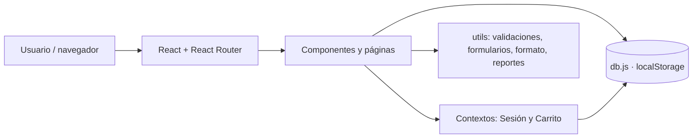
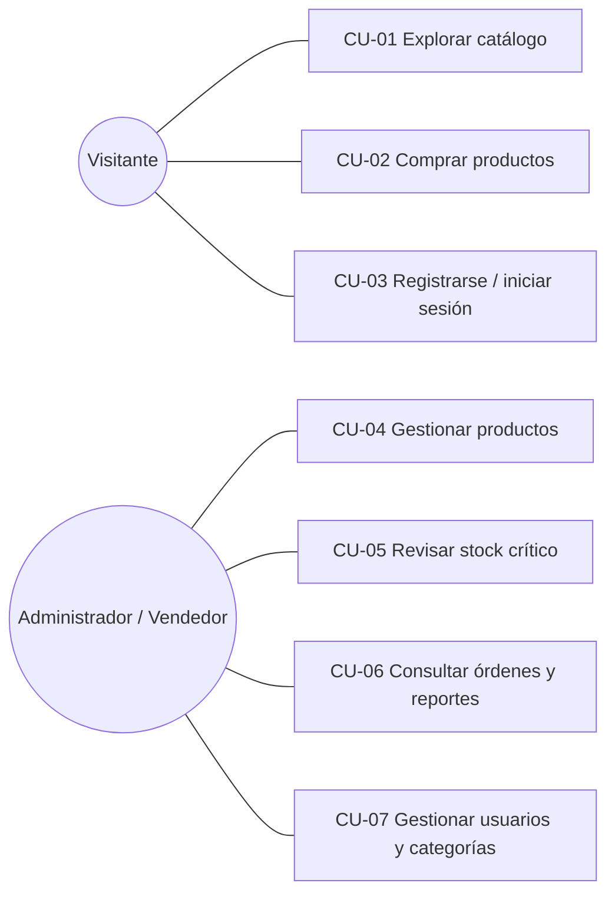
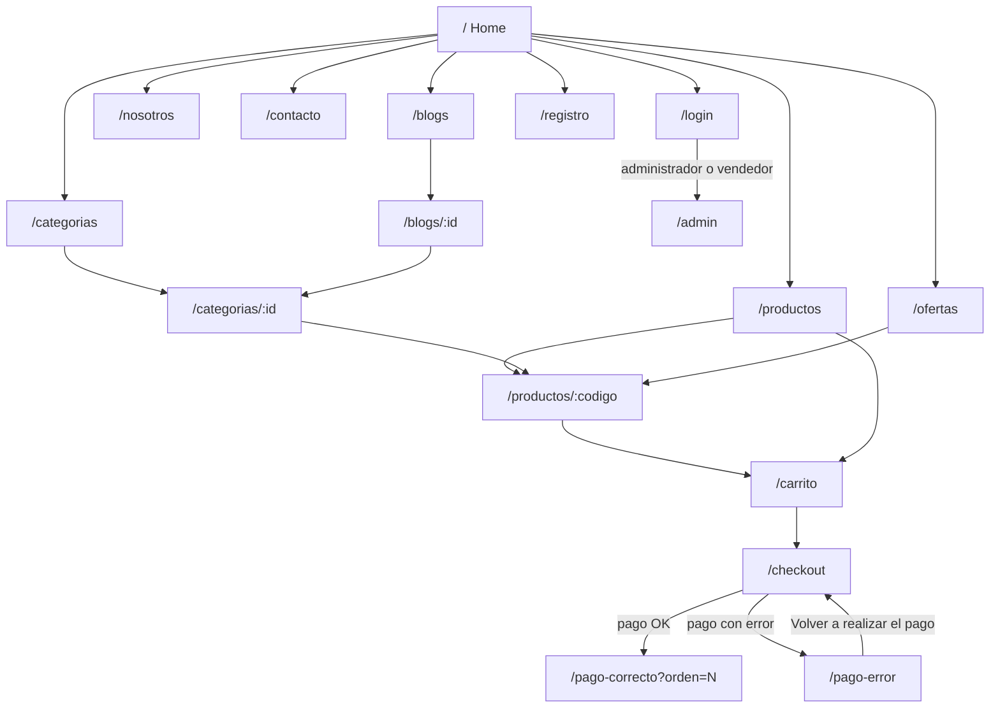
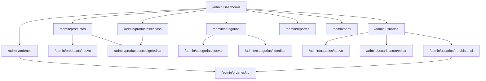

# Especificación de Requisitos de Software (ERS) — Sonido Vivo v2

Formato: IEEE 830 simplificado · **Versión 2.1** · Fecha: 16-10-2026
Asignatura: DSY1104 Desarrollo Fullstack II (Duoc UC) · Evaluación Parcial 2
Equipo: Equipo de Desarrollo Front

> **Nota sobre versiones.** Este documento reemplaza a la ERS v1.0 (11-09-2026), que describía el prototipo de la Etapa 1 en HTML/CSS/JS. La v2.0 se reescribió a partir del proyecto real de la Etapa 2 (React). La sección 9 explica qué cambió de la Etapa 1 a la Etapa 2 y la sección 10 relaciona cada requisito de la v1 con la v2.

| Fecha | Versión | Autor | Modificación |
|---|---|---|---|
| 11-09-2026 | 1.0 | Analista de Sistemas | Versión inicial: diagnóstico y justificación de la solución (prototipo HTML/CSS/JS) |
| 08-10-2026 | 2.0 | Equipo de Desarrollo Front | Reescritura para la Etapa 2 (React): carrito con checkout y pago simulado, panel de administración ampliado, pruebas y trazabilidad |
| 16-10-2026 | 2.1 | Equipo de Desarrollo Front | Se incorporan los cupones de descuento de la v1 (RF-29, RF-30), se agrega la sección 10 (equivalencia v1 → v2), el menú móvil se cierra al elegir una opción, Carrito e Iniciar/Cerrar sesión quedan siempre visibles en el navbar, nueva portada con hero fotográfico y categorías con foto (RF-01), logo en el navbar (RNF-08) y se actualizan las cifras de pruebas |

---

## 1. Introducción

### 1.1 Propósito
Describir de forma completa y verificable lo que debe hacer la tienda online **Sonido Vivo** en su Etapa 2, para que el equipo, el profesor y futuros mantenedores compartan la misma definición del sistema y puedan comprobar que cada requisito tiene un componente que lo implementa y una prueba que lo verifica.

### 1.2 Alcance
Sonido Vivo es una tienda online de instrumentos musicales, audio y accesorios (Viña del Mar, Región de Valparaíso). El sistema incluye:

- **Tienda pública:** catálogo, búsqueda y filtros, categorías, ofertas, carrito con cupones de descuento, registro e inicio de sesión, checkout, pago simulado, blogs y contacto.
- **Panel de administración:** métricas, órdenes/boletas, productos (incluye críticos), categorías, usuarios, reportes y perfil.

**Fuera de alcance:** servidor, base de datos real, pasarela de pago real, envío real de correos, autenticación segura. Todo funciona en el navegador y los datos se guardan en `localStorage` (ver 2.3).

### 1.3 Definiciones, acrónimos y abreviaturas

| Término | Significado |
|---|---|
| ERS | Especificación de Requisitos de Software |
| SPA | *Single Page Application*: una sola página que cambia de vista sin recargar |
| CRUD | Crear, obtener (leer), actualizar y eliminar |
| CLP | Peso chileno; se muestra como `$129.990` |
| RUN | Rol Único Nacional chileno, con dígito verificador (`12345678-5`) |
| Stock crítico | Nivel de existencias por producto a partir del cual hay que reponer: un producto es crítico cuando `stock <= stockCritico` (por defecto 3) |
| Orden / boleta | Registro de una compra pagada |
| `db.js` | Base de datos simulada sobre `localStorage` (`src/data/db.js`) |
| Context | Mecanismo de React para compartir estado (sesión, carrito) sin pasar props por muchos niveles |
| SRP | *Single Responsibility Principle*: un componente, una responsabilidad |

### 1.4 Referencias
- ERS v1.0 (11-09-2026), Evaluación Parcial 1, anexo 4 (formato IEEE 830).
- Repositorio de la Etapa 1: https://github.com/chabedd/Tienda-Sonido-Vivo
- Documentación de React, React Router, Bootstrap 5, Vite y Vitest.
- Pauta de la Evaluación Parcial 2 de DSY1104.

---

## 2. Descripción general

### 2.1 Perspectiva del producto
Aplicación web de una sola página (SPA) construida con React. No depende de ningún servidor: la "base de datos" (`src/data/db.js`) persiste en el `localStorage` del navegador y se siembra con el catálogo original (51 productos en 10 categorías) migrado desde `productos-data.js` de la Etapa 1.

### 2.2 Usuarios

| Usuario | Descripción | Puede |
|---|---|---|
| **Visitante** | Persona sin sesión | Ver catálogo, categorías, ofertas, blogs; usar el carrito; registrarse; iniciar sesión; comprar (el checkout no exige sesión) |
| **Cliente** | Usuario registrado (tipo `Cliente`) | Todo lo anterior; sus datos se autocompletan en el checkout |
| **Administrador / Vendedor** | Usuario de tipo `Administrador` o `Vendedor` | Además, entrar a `/admin/*` y gestionar productos, categorías, usuarios, órdenes y reportes |

### 2.3 Restricciones
- **R-01** Frontend únicamente: sin servidor, sin base de datos real. Los datos viven en el navegador y se pierden si el usuario borra los datos del sitio.
- **R-02** El control de acceso al panel es solo de interfaz (no es seguridad real). Las contraseñas se guardan en texto plano en `localStorage` porque es una simulación académica; **no** debe usarse con datos reales.
- **R-03** Stack obligatorio: Vite + React (JavaScript, sin TypeScript), react-router-dom, Bootstrap 5 y pruebas con Vitest.
- **R-04** Correos aceptados solo de los dominios `@duoc.cl`, `@profesor.duoc.cl` y `@gmail.com` (regla heredada de la Etapa 1).
- **R-05** Las regiones y comunas disponibles son las 6 regiones definidas en `src/utils/regiones-comunas.js`.
- **R-06** El pago y el envío de la boleta por email son **simulados**.

### 2.4 Supuestos y dependencias
- **S-01** El navegador soporta `localStorage` y JavaScript moderno.
- **S-02** Las imágenes de los productos se cargan desde URL externas; sin internet se ve el texto alternativo. Las fotos de la portada (hero y categorías) van incluidas en `public/img/portada` y no dependen de internet.
- **S-03** Cuentas de demostración incluidas en la semilla (solo para pruebas y evaluación):

  | Tipo | Correo | Contraseña |
  |---|---|---|
  | Administrador | maria.perez@gmail.com | admin123 |
  | Vendedor | carlos.munoz@duoc.cl | vend123 |
  | Cliente | camila.rojas@gmail.com | cli123 |

- **S-04** El carrito y la sesión se conservan al recargar la página.

---

## 3. Requisitos funcionales

Prioridad: **A** alta, **M** media. Cada requisito se traza a componentes y pruebas en la sección 8.

### 3.1 Módulo Tienda

| ID | Requisito | Prio. |
|---|---|:-:|
| RF-01 | El sistema debe mostrar una portada con un hero fotográfico (mensaje de marca y botón **Explorar productos**), la sección **Explora las categorías** con una tarjeta por categoría (foto, nombre y lema, enlazada a su página) y ofertas destacadas. Una categoría sin foto (por ejemplo, creada desde el panel) usa su color de marca y muestra su cantidad de productos | M |
| RF-02 | El sistema debe listar el catálogo completo y permitir **buscar** por nombre, marca, modelo o código, filtrando en vivo | A |
| RF-03 | El sistema debe permitir **filtrar** el catálogo por categoría y mostrar la cantidad de resultados; si no hay coincidencias debe mostrar "No hay productos" | A |
| RF-04 | El sistema debe mostrar el **detalle** de un producto (imagen, marca, modelo, descripción, precio, stock) con selector de cantidad (limitada al stock) y botón **Añadir al carrito** | A |
| RF-05 | El sistema debe mostrar **tarjetas de categorías** y, al elegir una, los productos de esa categoría (la selección vive en la URL) | A |
| RF-06 | El sistema debe tener una vista de **Ofertas** con todos los productos en oferta, mostrando el precio normal tachado y el precio de oferta | A |
| RF-07 | Un producto en **stock crítico** debe mostrar la etiqueta "Stock crítico"; un producto sin stock debe mostrar "Sin stock" y no poder añadirse | M |
| RF-08 | El **carrito** debe listar los productos y permitir subir/bajar cantidades (en 0 se elimina), eliminar un producto, limpiar el carrito y ver el total. Cada producto se cobra al precio vigente (el de oferta si está en oferta) | A |
| RF-09 | El navbar debe mostrar en todo momento el **contador** de unidades del carrito | M |
| RF-10 | El sistema debe permitir **registrarse** validando RUN (con dígito verificador), nombre, apellidos, correo (formato y dominio), región → comuna, dirección y contraseña (4 a 10 caracteres) con confirmación; no debe permitir RUN ni correo repetidos | A |
| RF-11 | El sistema debe permitir **iniciar sesión** con correo y contraseña, validando en vivo y mostrando "Correo o contraseña incorrectos." cuando no coinciden | A |
| RF-12 | El navbar debe mostrar "Iniciar sesión / Registrarse" sin sesión, o el **nombre del usuario** y "Cerrar sesión" con sesión (y el enlace "Admin" a administradores y vendedores). **Carrito** e **Iniciar sesión / Cerrar sesión** deben verse siempre, en todos los tamaños de pantalla, fuera del menú desplegable móvil (en pantallas < 576 px solo como ícono con nombre accesible). La sesión se conserva al recargar | A |
| RF-13 | El **checkout** debe capturar datos del cliente y dirección de entrega (calle, departamento opcional, región → comuna, indicaciones opcionales), validar los campos y **autocompletarlos** si hay sesión iniciada. Con el carrito vacío debe avisar que no hay nada que pagar | A |
| RF-14 | Si el pago se realiza, el sistema debe crear la orden, descontar el stock, vaciar el carrito y mostrar **PagoCorrecto**: "Se ha realizado la compra nro #…", datos de entrega, resumen y los botones **Imprimir boleta** (`window.print`) y **Enviar por email** (simulado) | A |
| RF-15 | Si el pago falla, el sistema debe mostrar **PagoError**: "No se pudo realizar el pago", conservar el carrito y ofrecer **Volver a realizar el pago** | A |
| RF-16 | El sistema debe tener una página **Nosotros** con la historia de la tienda y el equipo | M |
| RF-17 | El sistema debe tener **Blogs** (lista) y **detalle de blog** (artículos 1 y 2), con enlace a la categoría relacionada | M |
| RF-18 | El sistema debe tener un formulario de **Contacto** (nombre y comentario obligatorios, correo opcional pero validado, contador de 500 caracteres) y confirmar el envío | M |
| RF-29 | El carrito debe permitir **aplicar un cupón** de descuento. Cupones válidos: `SONIDOVIVO10` (10 %) y `BIENVENIDO5` (5 %), sin distinguir mayúsculas ni espacios. Un cupón inválido muestra "El cupón ingresado no es válido." y no cambia el total; uno válido muestra "Cupón aplicado correctamente." y se puede quitar | M |
| RF-30 | Con un cupón aplicado, el carrito, el checkout y la boleta deben mostrar **subtotal, descuento y total a pagar**; el descuento se redondea a pesos enteros, el cupón se conserva al recargar y se descarta al vaciar el carrito o al pagar. La orden guarda el cupón y el descuento | M |

> RF-29 y RF-30 se agregaron en la v2.1. Se numeraron a continuación del último requisito existente (RF-28) para no cambiar los identificadores ya trazados en la sección 8.

### 3.2 Módulo Administración

| ID | Requisito | Prio. |
|---|---|:-:|
| RF-19 | El acceso a `/admin/*` debe estar restringido a usuarios `Administrador` o `Vendedor` con sesión; otros ven un aviso con enlace a iniciar sesión | A |
| RF-20 | El **Dashboard** debe mostrar tarjetas de métricas (compras y total vendido, productos y cuántos están críticos, usuarios) y accesos rápidos | A |
| RF-21 | El panel debe listar las **órdenes** (más recientes primero) y mostrar la **boleta** de cada una, imprimible | A |
| RF-22 | El panel debe permitir **listar (con búsqueda), crear, editar y eliminar productos** (eliminar con confirmación en dos pasos). El código es único y no se edita. Validaciones: código mínimo 3 caracteres, nombre máx. 100, descripción máx. 500, precio ≥ 0, stock entero ≥ 0, stock crítico entero opcional, precio de oferta ≤ precio normal | A |
| RF-23 | El panel debe tener un listado de **productos críticos** (`stock <= stock crítico`) | A |
| RF-24 | El panel debe permitir **listar, crear, editar y eliminar categorías**. No se puede eliminar una categoría con productos; al renombrarla se actualizan sus productos; no se permiten nombres repetidos | A |
| RF-25 | El panel debe permitir **listar, crear, editar y eliminar usuarios** (tipos Administrador, Vendedor, Cliente). No se permiten RUN ni correo repetidos; al editar, la contraseña vacía conserva la anterior; no se puede eliminar al usuario con la sesión activa | A |
| RF-26 | El panel debe mostrar el **historial de compras** de un usuario | M |
| RF-27 | El panel debe tener **Reportes**: total vendido, ticket promedio, unidades en stock, productos más vendidos y ventas por categoría | M |
| RF-28 | El panel debe tener una página de **Perfil** para que el usuario con sesión edite sus datos (sin poder cambiar su RUN, correo ni tipo) | M |

---

## 4. Requisitos no funcionales

| ID | Categoría | Requisito | Cómo se cumple |
|---|---|---|---|
| RNF-01 | **Responsividad** | La interfaz debe verse y usarse bien desde móvil (≈375 px) hasta escritorio | Bootstrap 5: navbar colapsable (`navbar-expand-lg` + `collapse`, abierto y cerrado con estado de React; se cierra al elegir una opción) con Carrito e Iniciar/Cerrar sesión fijos fuera del menú (botones de 44 × 44 px como mínimo), grillas `row`/`col-*`, `row-cols-*` para tarjetas, `table-responsive` para tablas |
| RNF-02 | **Usabilidad** | Los formularios deben validar mientras se escribe y explicar el error junto al campo; las acciones destructivas deben pedir confirmación; los estados vacíos deben tener mensaje | `utils/formularios.prepararFormulario` + `FormField` (`is-invalid`/`invalid-feedback`), `ConfirmButton`, mensajes "No hay productos" / "Tu carrito está vacío" |
| RNF-03 | **Rendimiento** | La navegación entre vistas no debe recargar la página; el listado de 51 productos debe filtrarse al instante | SPA con React Router; listas calculadas al dibujar la página (sin estado duplicado); imágenes con `loading="lazy"`. El build de producción pesa unos 105 kB comprimidos (gzip) de JavaScript, porque solo se carga el CSS de Bootstrap |
| RNF-04 | **Mantenibilidad** | Componentes con una sola responsabilidad, comunicados por props; lógica reutilizable fuera de la interfaz; nombres descriptivos en español | Componentes presentacionales (`ProductCard`, `CartTable`, `Navbar`…), páginas que orquestan, `utils/` puros, contextos para sesión y carrito, comentarios que explican props, estado y Bootstrap |
| RNF-05 | **Persistencia** | Los datos (catálogo, usuarios, órdenes, carrito, sesión) deben sobrevivir a recargas; datos corruptos no deben romper la aplicación | `db.js` sobre `localStorage`; lectura tolerante a JSON corrupto (vuelve a sembrar); carrito y sesión también tolerantes |
| RNF-06 | **Consistencia de datos** | La interfaz debe reflejar de inmediato los cambios en los datos | Cada página lee `db.js` al dibujarse; las que modifican datos (borrar) vuelven a leer la lista y actualizan su estado |
| RNF-07 | **Testabilidad** | La lógica debe poder probarse sin navegador real; cobertura de líneas alta | Funciones puras, Vitest + Testing Library + jsdom; 172 pruebas, 100 % de líneas |
| RNF-08 | **Identidad de marca** | Se debe mantener el nombre "Sonido Vivo" y los colores de la Etapa 1, y mostrar el logo de la tienda en el navbar | Logo en `public/img/logo-sonido-vivo.png` (fondo transparente, `alt="Sonido Vivo"`); variables CSS (`--sv-gold`, `--sv-surface`…) que sobrescriben las `--bs-*` de Bootstrap en `src/styles/theme.css` |
| RNF-09 | **Seguridad (limitada)** | No se almacena la contraseña en la sesión; el panel exige rol | Alcance académico, ver restricción R-02 |
| RNF-10 | **Portabilidad** | La tienda debe funcionar en las versiones recientes de Chrome, Edge, Firefox y Safari, y en Windows, macOS, Linux, Android e iOS (requisito heredado de la v1) | Solo se usan APIs estándar (`localStorage`, `window.print`) y Bootstrap 5; sin dependencias de sistema operativo. Verificación manual |

---

## 5. Casos de uso principales

**CU-01 Explorar catálogo** — *Actor:* visitante. *Flujo:* entra a Productos → escribe en el buscador y/o elige una categoría → la lista se reduce en vivo → abre el detalle de un producto. *Alterno:* sin resultados → "No hay productos".

**CU-02 Comprar productos** — *Actor:* visitante o cliente. *Precondición:* carrito con al menos un producto. *Flujo:* añade productos (el contador sube) → abre el Carrito y ajusta cantidades → (opcional) aplica un cupón → pulsa "Ir a pagar" → completa/revisa el checkout (con sesión se autocompleta) → "Pagar ahora" → ve "Se ha realizado la compra nro #…" → imprime la boleta o la "envía por email". *Alternos:* cupón inválido → aviso y el total no cambia; datos inválidos → se muestran los errores y no avanza; stock insuficiente → aviso; pago con error → PagoError y "Volver a realizar el pago" (el carrito se conserva).

**CU-03 Registrarse / iniciar sesión** — *Actor:* visitante. *Flujo registro:* completa el formulario (validación en vivo) → se crea el usuario `Cliente` y se abre su sesión. *Flujo login:* correo y contraseña → entra (administrador y vendedor van al panel). *Alternos:* RUN o correo repetido; credenciales incorrectas.

**CU-04 Gestionar productos** — *Actor:* administrador/vendedor. *Flujo:* Productos → Nuevo producto / Editar / Eliminar (con confirmación). *Alterno:* código duplicado → error.

**CU-05 Revisar stock crítico** — *Actor:* administrador/vendedor. *Flujo:* entra a Productos críticos → ve los productos con `stock <= stock crítico` → edita el producto para reponer.

**CU-06 Consultar órdenes y reportes** — *Actor:* administrador/vendedor. *Flujo:* Órdenes → "Ver boleta" → imprimir; o Reportes → ventas, ticket promedio, más vendidos.

**CU-07 Gestionar usuarios y categorías** — *Actor:* administrador/vendedor. *Flujo:* crear/editar/eliminar; ver historial de compras de un usuario. *Alternos:* no se elimina una categoría con productos ni al usuario con sesión activa.

---

## 6. Mapa de navegación

### 6.1 Tienda

### 6.2 Administración

---

## 7. Arquitectura y stack tecnológico

| Capa | Tecnología | Uso |
|---|---|---|
| Interfaz | **React 19** (JavaScript) | Componentes, `useState`, `useEffect`, `useMemo`, `useReducer`, Context |
| Herramienta de build | **Vite 8** | Servidor de desarrollo y build de producción |
| Navegación | **react-router-dom 7** | Rutas anidadas con dos layouts (`StoreLayout`, `AdminLayout`) |
| Estilos | **Bootstrap 5.3** (paquete npm) | Navbar colapsable, grillas, cards, formularios, tablas; tema de marca en `theme.css` |
| Datos | `localStorage` vía `src/data/db.js` | CRUD genérico (`crear`, `obtener`, `listar`, `actualizar`, `eliminar`) |
| Pruebas | **Vitest 5** + Testing Library + jsdom + `@vitest/coverage-v8` | Pruebas unitarias y de integración, cobertura |

**Organización de `src/`:** `components/` (piezas reutilizables, una responsabilidad cada una), `pages/` y `pages/admin/` (una por vista), `layouts/`, `context/` (sesión y carrito), `data/` (`db.js`, `seed.js`), `utils/` (módulos puros: validaciones, formularios, roles, regiones-comunas, formato, productos, reportes) y `__tests__/`.

**Decisiones de diseño (para la exposición oral):**
- *Props vs. estado vs. contexto:* los componentes visuales (`ProductCard`, `CartTable`, `Navbar`…) son "tontos": reciben datos y callbacks por **props**. El **estado local** (`useState`) se usa solo donde pertenece a la pantalla (texto de búsqueda, cantidad elegida, confirmación en dos pasos). Lo que necesitan varias ramas del árbol —sesión y carrito— va en **Context**.
- *Datos derivados:* la lista filtrada de productos no se guarda en estado; se calcula al dibujar la página a partir de datos + filtros.
- *Sin hooks propios de lógica:* aparte de `useCart` y `useSession`, que solo dan acceso a los contextos, cada página y formulario usa directamente `useState` y funciones puras (`listar`, `prepararFormulario`); así se ve en un solo archivo de dónde sale cada dato.
- *Reglas de negocio fuera de la interfaz:* validaciones, stock crítico, precio vigente y reportes son funciones puras en `utils/`, reutilizadas por los formularios y por las pruebas.
- *Bootstrap con identidad propia:* se usan las clases de Bootstrap y se sobrescriben sus variables (`--bs-primary`, etc.) con la paleta dorada/café de la Etapa 1.

---

## 8. Plan de pruebas y trazabilidad

### 8.1 Plan de pruebas
- **Nivel:** pruebas unitarias (funciones puras, `db.js`, componentes) y de integración ligera (páginas completas dentro de un `MemoryRouter`).
- **Herramientas:** Vitest, Testing Library (`render`, `screen`, `userEvent`), jsdom, mocks con `vi.spyOn` y `vi.fn()`.
- **Criterios de aceptación:** todas las pruebas pasan (`npm test`) y se genera el informe de cobertura (`npm run coverage`).
- **Resultado de la última ejecución:** 10 archivos, **172 pruebas, todas pasan**; cobertura de sentencias 99.86 %, ramas 91.52 %, funciones 99.6 %, líneas 100 %.
- **Detalle y análisis:** ver `docs/PRUEBAS UNITARIAS/informe_cobertura.md`.

### 8.2 Matriz de trazabilidad (requisito ↔ componente ↔ prueba)

| Requisito | Componentes / módulos | Pruebas (archivo · nombre abreviado) |
|---|---|---|
| RF-01 | `pages/Home`, `CategoryCard`, `ProductGrid`, `data/portada` | `paginas` · Home, Nosotros y NotFound se renderizan; Home muestra las 10 categorías con foto y lema; `componentes` · CategoryCard recibe categoría y cantidad; CategoryCard con imagen y lema |
| RF-02 | `pages/Productos`, `SearchBar`, `utils/productos.filtrarProductos` | `paginas` · la búsqueda reduce la lista; `validaciones` · filtrarProductos busca por texto y por categoría; `componentes` · SearchBar avisa cada cambio |
| RF-03 | `pages/Productos`, `ProductGrid` | `paginas` · el filtro por categoría; una búsqueda sin resultados muestra "No hay productos"; `componentes` · ProductGrid vacío |
| RF-04 | `pages/DetalleProducto`, `ProductCard` | `paginas` · DetalleProducto añade la cantidad elegida; código inexistente avisa; `componentes` · ProductCard recibe nombre, precio CLP e imagen |
| RF-05 | `pages/Categorias`, `CategoryCard` | `paginas` · Categorías por URL muestra sus productos; categoría inexistente avisa |
| RF-06 | `pages/Ofertas`, `utils/productos.precioVigente` | `paginas` · Ofertas muestra solo productos en oferta; `componentes` · ProductCard en oferta; `validaciones` · precioVigente |
| RF-07 | `CriticalBadge`, `ProductCard`, `utils/productos.esStockCritico` | `componentes` · producto en stock crítico muestra la etiqueta; ProductCard deshabilita el botón sin stock; `validaciones` · esStockCritico |
| RF-08 | `pages/Carrito`, `CartTable`, `context/CartContext` | `paginas` · Carrito: la cantidad sube y baja y el total se recalcula; Limpiar carrito; reducer del carrito; el carrito cobra el precio de oferta; `componentes` · CartTable filas y total, vacío, eventos +/−/Eliminar |
| RF-29 / RF-30 | `utils/cupones`, `context/CartContext`, `pages/Carrito`, `CartTable`, `pages/Checkout`, `OrderSummary` | `cupones` · reconoce cupones válidos e inválidos; calcula 10 % y 5 %; aplicar, cupón inválido, quitar; se conserva y se borra al limpiar; cupón corrupto; checkout con descuento; localStorage no disponible |
| RF-09 | `Navbar`, `StoreLayout`, `CartContext` | `paginas` · añadir al carrito actualiza el contador del navbar; CartProvider persiste el carrito |
| RF-10 | `pages/Registro`, `FormField`, `RegionComunaFields`, `utils/formularios`, `utils/validaciones` | `paginas` · registro inválido/válido, correo existente, RUN existente, comuna depende de la región; `validaciones` · RUN, correo, confirmación de contraseña |
| RF-11 | `pages/Login`, `db.autenticar` | `paginas` · submit inválido muestra errores; validación en vivo; credenciales incorrectas; vendedor entra al panel; `db` · autenticar |
| RF-12 | `Navbar`, `context/SessionContext`, `StoreLayout`, `utils/roles` | `componentes` · Navbar con y sin sesión, el menú móvil se abre, se cierra y se cierra al elegir una opción, Carrito y sesión fuera del menú y sin duplicar, enlace Admin a administradores y vendedores pero no a clientes; `paginas` · cliente queda con sesión, cerrar sesión; SessionProvider sin contraseña |
| RF-13 | `pages/Checkout`, `FormField`, `utils/regiones-comunas` | `pago` · Checkout autocompleta datos; datos inválidos no avanza; `casos-borde` · stock insuficiente, cambiar región limpia comuna; `paginas` · checkout con carrito vacío |
| RF-14 | `pages/PagoCorrecto`, `OrderSummary`, `db.crear` | `pago` · pago exitoso (orden, stock, carrito vacío); Imprimir boleta y Enviar por email; orden inexistente |
| RF-15 | `pages/PagoError` | `pago` · pago con error muestra PagoError y conserva el carrito |
| RF-16 | `pages/Nosotros` | `paginas` · Home, Nosotros y NotFound se renderizan |
| RF-17 | `pages/Blogs`, `pages/DetalleBlog` | `paginas` · Blogs lista ambos artículos y el detalle; DetalleBlog inexistente avisa |
| RF-18 | `pages/Contacto`, `FormField` | `paginas` · Contacto cuenta caracteres, valida y confirma; `validaciones` · contacto: correo opcional |
| RF-19 | `layouts/AdminLayout`, `utils/roles` | `App` · /admin sin sesión pide iniciar sesión, con sesión de administrador o vendedor muestra sidebar; `formularios` · roles con acceso; `admin` · un cliente no puede entrar |
| RF-20 | `pages/admin/Dashboard`, `StatCard` | `admin` · el dashboard muestra las métricas; `componentes` · StatCard |
| RF-21 | `pages/admin/Ordenes`, `DetalleOrden`, `OrderSummary` | `admin` · lista las órdenes y abre la boleta; sin órdenes; `casos-borde` · orden de las órdenes, boleta imprimible |
| RF-22 | `pages/admin/ProductosAdmin`, `ProductoNuevo`, `ProductoEditar`, `ProductoForm`, `ProductosTabla`, `ConfirmButton`, `db` | `admin` · crear válido, código existente, errores de precio/stock, precio de oferta, editar, eliminar con confirmación, buscar; `db` · CRUD completo con mocks; `validaciones` · rangos |
| RF-23 | `pages/admin/ProductosCriticos`, `CriticalBadge` | `admin` · la lista de críticos incluye solo productos con stock <= crítico |
| RF-24 | `pages/admin/CategoriasAdmin`, `CategoriaNueva`, `CategoriaEditar`, `CategoriaForm` | `admin` · crear, repetida, no eliminar con productos, eliminar sin productos, renombrar actualiza productos, renombrar con el nombre de otra categoría avisa |
| RF-25 | `pages/admin/UsuariosAdmin`, `UsuarioNuevo`, `UsuarioEditar`, `UsuarioForm` | `admin` · crear, RUN/correo duplicados, editar conserva o cambia contraseña, editar con el correo de otro usuario avisa, no eliminar sesión activa |
| RF-26 | `pages/admin/HistorialCompras`, `db.ordenesDeUsuario` | `admin` · el historial incluye solo sus compras; vacío e inexistente; `db` · ordenesDeUsuario |
| RF-27 | `pages/admin/Reportes`, `utils/reportes` | `admin` · resumenVentas totales, sin órdenes, página de reportes; `casos-borde` · ordena por unidades |
| RF-28 | `pages/admin/Perfil` | `admin` · el perfil actualiza datos propios y bloquea el tipo; sin usuario real pide iniciar sesión |
| RNF-01 | Clases Bootstrap en todos los componentes | Verificación manual en navegador (ancho móvil y escritorio) |
| RNF-02 | `utils/formularios`, `FormField`, `ConfirmButton`, `AlertMessage` | `componentes` · FormField/AlertMessage condicionales; ConfirmButton; `formularios` · errores visibles al escribir o enviar |
| RNF-10 | Estándares web, sin dependencias de plataforma | Verificación manual en navegadores |
| RNF-05 / RNF-06 | `data/db.js` | `db` · siembra, JSON corrupto, copia de datos; `admin` · las tablas se actualizan tras eliminar; `paginas` · carrito/sesión corruptos |
| RNF-07 | Toda la carpeta `utils/`, `data/` | `npm run coverage` (informe de cobertura) |

---

## 9. Qué cambió respecto a la Etapa 1 (HTML → React)

| Aspecto | Etapa 1 | Etapa 2 |
|---|---|---|
| Tecnología | HTML + CSS propio + JavaScript vanilla (19 archivos JS sueltos) | Vite + React (JS) + react-router-dom |
| Estructura de carpetas | Raíz del repositorio | `fase1/proyecto_etapa1_html` (intacta, movida con `git mv`), `fase2/proyecto_Etapa2_REACT`, `docs/` |
| Páginas | 11 HTML + 7 HTML de admin (se repetía el navbar y el footer en cada archivo) | Un componente por vista (`pages/`), con `StoreLayout` y `AdminLayout` que comparten navbar, footer y sidebar |
| Diseño | CSS propio sin framework | Bootstrap 5 + variables de marca en `theme.css` |
| Datos | Catálogo en `productos-data.js` y copias separadas en `localStorage` para productos y usuarios del admin | `db.js` unificado: productos, categorías, usuarios, órdenes y blogs con CRUD genérico, siembra |
| Validaciones | `validaciones.js` mezclado con manipulación del DOM | Módulo puro `utils/validaciones.js` + `FormField` que recibe el error por props; reutilizado por formularios y pruebas |
| Carrito y sesión | Funciones globales y contador actualizado a mano en el DOM | `CartContext` y `SessionContext`; el contador se actualiza solo |
| Login | Solo validaba, sin sesión | Autentica contra los usuarios, guarda la sesión y adapta navbar y panel |
| Vistas nuevas | — | Categorías, Ofertas, Checkout, PagoCorrecto, PagoError; en admin: Dashboard, Órdenes/Boletas, Categorías, productos críticos, historial de compras, Reportes y Perfil |
| Datos nuevos | Productos sin ofertas ni stock crítico propio | Campos `oferta`, `precioOferta` y `stockCritico` por producto; órdenes |
| Pruebas | Ninguna | 172 pruebas con Vitest, informe de cobertura |
| Cupones | `SONIDOVIVO10` y `BIENVENIDO5` en `carrito-page.js` | Se mantienen (RF-29, RF-30) en `utils/cupones.js` y `CartContext`; además quedan registrados en la orden y la boleta |
| Acceso al admin | Libre | Restringido a Administrador/Vendedor con sesión |

**Se mantuvo:** el nombre y la identidad de marca (colores dorado/café), el catálogo de 51 productos con sus imágenes y precios, las reglas de validación (dominios de correo, RUN, largos) y las regiones/comunas.

---

## 10. Equivalencia de requisitos v1 → v2

La v1 usaba RF-01…RF-37 y RNF-01…RNF-16 para el prototipo HTML. La v2 renumera y reorganiza los requisitos por módulo. Esta tabla permite rastrear cada requisito de la v1.

| Requisitos v1 | Tema | En la v2 | Estado |
|---|---|---|---|
| RF-01, RF-02 | Inicio y navegación | RF-01, RF-12 | Mantenido |
| RF-03, RF-04 | Nosotros y blogs | RF-16, RF-17 | Mantenido |
| RF-05 | Menú móvil con control de apertura | RNF-01 (navbar colapsable de Bootstrap) | Mantenido |
| RF-06, RF-07, RF-08 | Datos del producto, filtro por categoría, detalle por código | RF-02 a RF-05 | Mantenido y ampliado (búsqueda, ofertas) |
| RF-09, RF-10, RF-11, RF-12 | Disponibilidad, cantidad, añadir al carrito, código inexistente | RF-04, RF-07 | Mantenido |
| RF-13, RF-14, RF-15, RF-16, RF-19 | Carrito persistente, cantidades, totales, carrito vacío | RF-08, RF-09 | Mantenido |
| RF-17, RF-18 | Cupones válidos y aviso de validez | RF-29, RF-30 | **Recuperado en la v2.1** |
| RF-20 | Acción de pago | RF-13, RF-14, RF-15 | Ampliado: checkout, orden y pago simulado |
| RF-21 a RF-26 | Registro, RUN, correo, región/comuna, mensajes de error | RF-10 | Mantenido |
| RF-27 | Validar inicio de sesión | RF-11 | Ampliado: ahora autentica y guarda la sesión |
| RF-28, RF-29, RF-30 | Contacto, contador de 500 caracteres, confirmación | RF-18 | Mantenido |
| RF-31 a RF-37 | Panel de productos (listar, crear, editar, eliminar, validar, persistir) | RF-19 a RF-23, RNF-05 | Mantenido y ampliado (categorías, usuarios, órdenes, reportes) |
| RNF-01 | Catálogo actualizado en 2 s o menos | RNF-03 | Reformulado: la navegación es instantánea en el navegador |
| RNF-02 | Carrito actualiza totales de inmediato | RF-08, RNF-06 | Mantenido |
| RNF-03, RNF-06 | Autenticación, validación cliente/servidor | R-02, RNF-09 | Limitado: no hay servidor (restricción R-01) |
| RNF-04 | Contraseñas cifradas | R-02 | **No cumplido** en la v2: se guardan en texto plano por ser una simulación académica |
| RNF-05 | HTTPS | — | No aplica sin servidor; queda como requisito de una versión productiva |
| RNF-07, RNF-08 | Datos corruptos y carrito persistente | RNF-05, S-04 | Mantenido |
| RNF-09, RNF-10 | Disponibilidad | — | No aplica a un sitio estático sin servicio propio |
| RNF-11, RNF-12, RNF-13 | Mantenibilidad | RNF-04, RF-22 | Mantenido |
| RNF-14, RNF-15, RNF-16 | Portabilidad | RNF-10 | Recuperado en la v2.1 |
